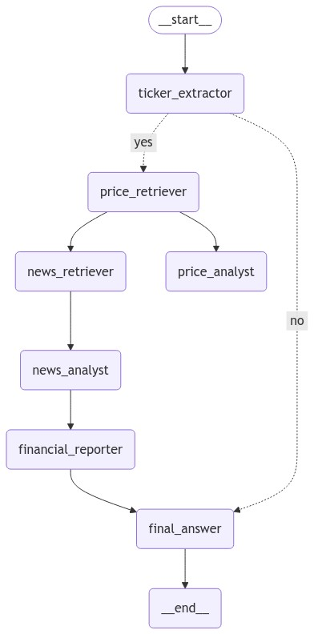

# Financial Advice Agent

Financial Advice Agent is an AI-powered assistant built using LangGraph. It gives financial insights by looking at cryptocurrency prices and related news articles. It is built in separate, easy-to-manage parts, and each part uses AI tools to find, collect, study, and report financial data.

### The Financial Advice Agent works in these steps:
1. Ticker Extractor: Finds the cryptocurrency ticker(s) (short names like BTC or ETH) in what you type.
2. Price Retriever: Gets the latest cryptocurrency prices for those ticker(s).
3. News Retriever: Collects news articles about those ticker(s).
4. News Analyst: Reads the collected news and pulls out useful insights.
5. Price Analyst: Studies how the price has been moving and what patterns it shows.
6. Financial Reporter: Brings together the news and price findings to write a complete financial summary.
7. Final Answer: Shows you the final financial report or advice.




For a more detailed look at how it is built, see the diagram included in this repository.

## Features
• Finds cryptocurrency tickers in what the user types.
• Gets live cryptocurrency price data.
• Studies related financial news articles.
• Gives practical advice based on price movement and news.
• Writes complete financial reports.

## Setup Instructions

### Requirements
• Python 3.10.11
• Make sure pip is installed.

### Installation
1. Download the repository:
```
git clone <repository_url>
cd Financial-advice-agent
```

2. Install the packages the project needs:
```
pip install -r requirements.txt
```

3. Add your Groq and OpenBB API keys, either in a .env file or by editing main.py at line 28 and line 30.
4. Start the Streamlit app:
```
streamlit run main.py
```


## Usage
1. Open the app in your browser (it usually runs at http://localhost:8501).
2. Type the cryptocurrency ticker or your finance question in the input box.
3. Read the AI-generated insights, analysis, and financial advice.

## Packages Used

All the packages are listed in the requirements.txt file. These include:
	•	LangGraph (runs the step-by-step workflow)
	•	Streamlit (builds the web page you see)
	•	Other important libraries for getting data, understanding text, and analysis

